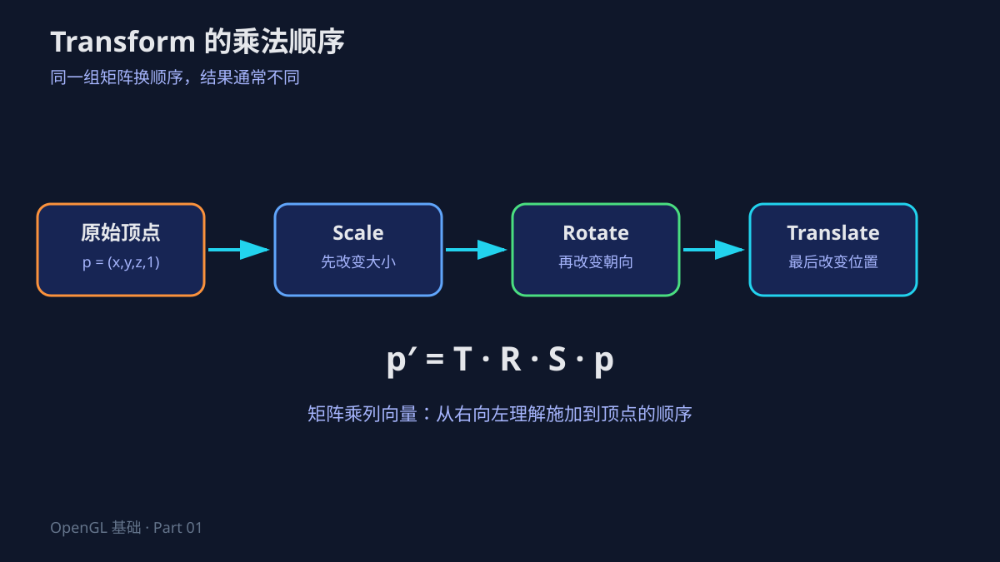

# Part 01 第 10 课：Transform 与 GLM

适用环境：C++17、OpenGL 3.3 Core、GLSL 330 和 GLM。建议先复习第 0 部的齐次坐标与矩阵乘法。

你将学会：

- 用 GLM 构造平移、旋转和缩放矩阵。
- 在矩阵乘列向量约定下解释组合顺序。
- 使用 `glUniformMatrix4fv` 上传 `glm::mat4`。
- 通过时间和暂停开关观察连续旋转。

完整示例位于 [code/part-01-10-transform](../code/part-01-10-transform/)。

## 为什么需要 Model Matrix

前面的顶点数组直接给出屏幕附近的位置。真实场景通常把几何定义在物体自己的局部坐标中，再通过 Model Matrix 放置到世界：

- Scale 调整大小。
- Rotate 调整朝向。
- Translate 调整位置。

同一个矩形网格可以搭配不同 Model Matrix 绘制为多个物体，不需要复制或修改 VBO。

## 三种基础变换

### 缩放

```cpp
glm::mat4 scale = glm::scale(glm::mat4{1.0F}, glm::vec3{0.8F, 0.8F, 1.0F});
```

X、Y 缩小为 80%，Z 不变。缩放以局部原点为中心，因此顶点离原点的距离也改变。

### 旋转

```cpp
float angle = simulationTime;
glm::mat4 rotation = glm::rotate(glm::mat4{1.0F}, angle, glm::vec3{0.0F, 0.0F, 1.0F});
```

角度单位是弧度，第二个参数不是角度制。Z 轴旋转使二维矩形在屏幕平面内转动。旋转轴应是非零向量；需要时归一化。

### 平移

```cpp
glm::mat4 translation = glm::translate(glm::mat4{1.0F}, glm::vec3{0.25F, 0.10F, 0.0F});
```

平移依赖齐次坐标的 `w = 1`。方向通常使用 `w = 0`，因此不会受到平移影响。

## 组合顺序：从右向左看顶点经历什么

示例按以下代码构造矩阵：

```cpp
glm::mat4 model{1.0F};
model = glm::translate(model, glm::vec3{0.25F, 0.10F, 0.0F});
model = glm::rotate(model, simulationTime, glm::vec3{0.0F, 0.0F, 1.0F});
model = glm::scale(model, glm::vec3{0.8F, 0.8F, 1.0F});
```

最终等价于：

\[
M = T\,R\,S
\]

顶点按列向量右乘在矩阵之后：

\[
p' = M p = T R S p
\]

所以顶点先缩放，再旋转，最后平移。



如果改为 \(S R T\)，平移量也会被最后缩放；如果交换旋转和平移，物体会从“绕自身原点旋转后移动”变成“围绕另一个原点做轨道式运动”。矩阵乘法通常不满足交换律。

## 上传矩阵到 Shader

Vertex Shader 声明：

```glsl
uniform mat4 uModel;
void main() {
    gl_Position = uModel * vec4(aPos, 1.0);
    vColor = aColor;
}
```

CPU 端：

```cpp
glUseProgram(program);
glUniformMatrix4fv(
    glGetUniformLocation(program, "uModel"),
    1,
    GL_FALSE,
    glm::value_ptr(model)
);
```

参数含义：

- Location：`uModel` 在 Program 中的位置。
- Count：上传 1 个矩阵。
- Transpose：`GL_FALSE`，GLM 内存布局可直接按列主序提供。
- Value：矩阵首元素地址。

> ⚠️ 不要在未绑定目标 Program 时上传。也不要把 `transpose` 随意改为 `GL_TRUE` 来“修复方向”；先确认矩阵约定和数学顺序。

## 用模拟时间控制旋转

示例保存 `simulationTime`，每帧增加 `deltaTime`：

```cpp
const double now = glfwGetTime();
const float delta = static_cast<float>(now - previousTime);
previousTime = now;
if (!paused) simulationTime += delta;
```

按空格只暂停模拟时间，不暂停窗口事件和绘制。这样恢复时不会因为把暂停期间的绝对时间全部加入而突然跳转。

相比 `angle += 0.01`，使用秒作为时间单位让旋转速度不随帧率改变。若希望每秒旋转 90°，可写：

```cpp
simulationTime += delta * glm::radians(90.0F);
```

当前示例直接使用 `1 弧度/秒`。

## 当前还不是完整三维变换

本课只有 Model Matrix，输出仍直接处于适合二维显示的坐标范围。没有 View 和 Projection：

- Camera 尚未独立出来。
- 没有透视缩小效果。
- 窗口宽高比变化可能让图形看起来拉伸。

下一课会补上 View 和 Projection，形成完整 MVP 链。

## 运行示例

```powershell
cd tutorials/opengl-compute-shader/code/part-01-10-transform
cmake --preset debug
cmake --build --preset debug
.\build\debug\part01_10_transform.exe
ctest --preset debug
```

矩形围绕自身旋转并带有固定平移。按空格暂停/继续，按 `Esc` 退出。

## 常见错误

### 把旋转角度当成度

`glm::rotate` 使用弧度。写 `90.0F` 不是旋转 90°，应使用 `glm::radians(90.0F)`。

### 忘记先构造单位矩阵

从单位矩阵开始，再应用变换。未初始化矩阵或全零矩阵不能等价替代单位矩阵。

### 组合顺序与预期相反

用简单数值点验证，例如先对 `(1,0,0)` 缩放再平移。不要只通过反复交换代码碰运气。

### 旋转轴为零或方向错误

零轴没有有效旋转方向。二维屏幕旋转使用 Z 轴；三维物体根据所需轴向选择单位向量。

## 修改实验与独立练习

1. 交换 Rotate 和 Translate 的调用，描述运动轨迹的变化。
2. 把缩放改为非均匀缩放 `(1.5, 0.5, 1.0)`，观察旋转前后的外观。
3. 使用同一 VAO 绘制两个矩形，只改变每次 Draw Call 前的 `uModel`。
4. 独立推导并验证：一个顶点先平移 `(2,0,0)`，再缩放 2 倍，最终 X 是多少？交换顺序后又是多少？

下一课会构建 Model、View、Projection 三个矩阵，渲染有真实透视与遮挡的立方体。

参考资料：[GLM 手册](https://github.com/g-truc/glm/blob/master/manual.md)、[LearnOpenGL：Transformations](https://learnopengl.com/Getting-started/Transformations)。
