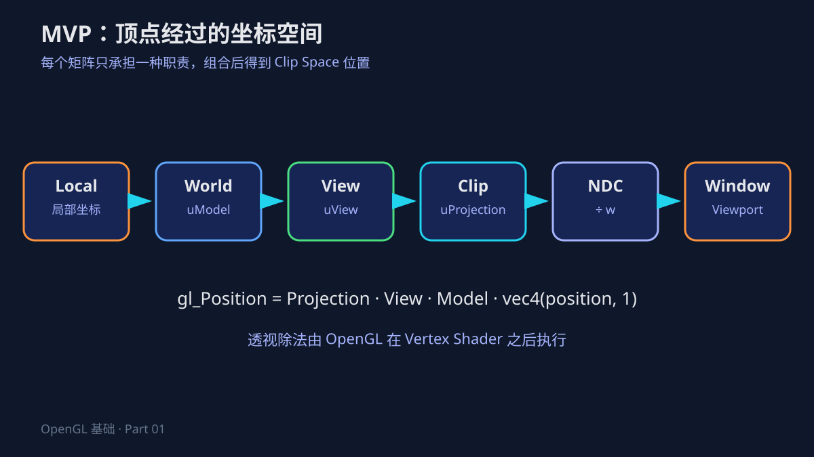

# Part 01 第 11 课：Model、View、Projection

适用环境：C++17、OpenGL 3.3 Core、GLSL 330 和 GLM。示例使用公共 CubeGeometry，包含 36 个顶点。

你将学会：

- 分离 Model、View 和 Projection 的职责。
- 按顺序解释 Local、World、View、Clip、NDC 和 Window Space。
- 设置 FOV、Aspect Ratio、Near/Far Plane。
- 理解 `gl_Position` 之后发生的透视除法与 Viewport 映射。

完整示例位于 [code/part-01-11-mvp](../code/part-01-11-mvp/)。

## 为什么需要三个矩阵

Model Matrix 只回答“物体在哪里、朝向如何、尺寸多大”。完整三维渲染还需要：

- **View Matrix**：从 Camera 视角观察世界。
- **Projection Matrix**：把可视空间映射到裁剪空间，并可制造透视效果。

这样物体运动、Camera 运动和镜头参数可以独立修改，而不必重写顶点数据。



Vertex Shader 的组合为：

```glsl
gl_Position = uProjection * uView * uModel * vec4(aPos, 1.0);
```

从右向左：局部顶点先进入 World，再进入 View，最后到 Clip Space。

## 逐个坐标空间理解

### Local Space

几何相对于物体自身原点的位置。本课立方体顶点范围是 `[-0.5, 0.5]`，中心位于局部原点。

### World Space

`uModel` 把局部顶点放到场景世界。本课 Model 只包含旋转，立方体仍在世界原点附近。

### View Space

`uView` 把世界转换为以 Camera 为观察原点的坐标。它并不移动窗口里的 Camera 图标，而是对世界施加 Camera 变换的逆变换。

### Clip Space

`uProjection` 输出齐次裁剪坐标。此时位置仍包含 `w`，不能直接把 `xyz` 当屏幕位置。裁剪阶段使用坐标与 `w` 的关系判断可视范围。

### NDC 与 Window Space

OpenGL 对 Clip Position 执行透视除法：

\[
(x_{ndc},y_{ndc},z_{ndc})=(x_{clip}/w_{clip},y_{clip}/w_{clip},z_{clip}/w_{clip})
\]

NDC 的可视范围在各轴为 `[-1,1]`。随后 Viewport 把 X、Y 映射到窗口像素，深度范围映射到深度缓冲区间。

## 构造三个矩阵

### Model：旋转物体

```cpp
glm::mat4 model{1.0F};
model = glm::rotate(
    model,
    time * 0.6F,
    glm::normalize(glm::vec3{0.4F, 1.0F, 0.2F})
);
```

旋转轴不必恰好是某个坐标轴，但必须非零。归一化使轴向语义明确。

### View：放置观察者

```cpp
const glm::mat4 view = glm::lookAt(
    glm::vec3{3.0F, 2.0F, 5.0F}, // Camera 位置
    glm::vec3{0.0F},              // 观察目标
    glm::vec3{0.0F, 1.0F, 0.0F}  // World Up
);
```

`lookAt` 根据位置、目标和上方向构造 View Matrix。Camera 位置不能恰好等于目标，否则观察方向为零向量。

### Projection：透视镜头

```cpp
const glm::mat4 projection = glm::perspective(
    glm::radians(45.0F), // 垂直 FOV
    aspect,               // 宽 / 高
    0.1F,                 // Near Plane
    100.0F                // Far Plane
);
```

- FOV 越大，视野越广，透视变形感通常越强。
- Aspect 必须匹配 Framebuffer 宽高比，否则图像会拉伸。
- Near 必须大于 0，Far 必须大于 Near。
- Near/Far 范围会影响深度精度；不要无意义地把 Near 设为极小、Far 设为极大。

> ⚠️ OpenGL 默认裁剪约定与某些其他图形 API 不同。本课使用 GLM 的 OpenGL 默认投影配置，不要直接混用为零到一深度范围设计的矩阵而不做适配。

## 为什么透视物体近大远小

透视投影产生的 `w` 通常随 View Space 深度变化。透视除法用 `w` 除 X、Y，使更远的顶点向视野中心收缩，从而形成近大远小。

这也是不能把 Projection Matrix 省略后还期待相同透视效果的原因。`gl_Position.w = 1` 的简单三角形没有这种除法变化。

## Depth Test 在这里先作为必要工具

立方体由多个相互遮挡的面组成。示例调用：

```cpp
glEnable(GL_DEPTH_TEST);
glClear(GL_COLOR_BUFFER_BIT | GL_DEPTH_BUFFER_BIT);
```

Depth Test 保留更近的 Fragment，每帧清除深度附件以恢复初始状态。本课先把它当作正确显示实心立方体的工具，第 13 课会详细修改并观察它。

## 上传与绘制

```cpp
glUseProgram(program);
tutorial::setMat4(program, "uModel", model);
tutorial::setMat4(program, "uView", view);
tutorial::setMat4(program, "uProjection", projection);
cube.draw();
```

公共 `setMat4` 使用 `glUniformMatrix4fv(..., 1, GL_FALSE, glm::value_ptr(value))`。View 和 Projection 在当前场景中对整帧保持一致，Model 可随每个物体改变。

## 运行示例

```powershell
cd tutorials/opengl-compute-shader/code/part-01-11-mvp
cmake --preset debug
cmake --build --preset debug
.\build\debug\part01_11_mvp.exe
ctest --preset debug
```

正常结果为具有透视效果、持续旋转的彩色立方体。调整窗口大小时 Projection 会使用新的 Framebuffer Aspect。

## 常见错误

### 立方体完全不可见

依次检查：Camera 是否朝错方向、物体是否在 Near/Far 外、矩阵是否为单位矩阵起点、MVP 顺序是否正确，以及 Face Culling 是否因其他状态误开启。

### 窗口拉伸后立方体变形

不要用固定 Aspect。每帧或回调中读取 Framebuffer 尺寸，计算 `float(width) / height`，并防止高度为 0。

### 把透视除法再手动执行一次

Vertex Shader 只需输出 Clip Position。OpenGL 后续会执行透视除法；不要提前对 `gl_Position.xyz` 除以 `w` 后又期望固定管线重复处理。

### Near/Far 设置不合理

Near = 0 不适合标准透视矩阵。过大的深度范围比也会降低有效深度精度，导致后续 Z-fighting。

## 修改实验与独立练习

1. 把 FOV 分别改为 30° 和 75°，比较视野。
2. 把 Camera 移到 `(0,0,5)`，再移到 `(5,0,0)`，保持观察原点。
3. 用不同 Model Matrix 绘制三个立方体，保持 View/Projection 不变。
4. 在纸上写出一点从 Local 到 Window 的六个坐标空间及对应变换，并标注哪一步由 Shader 外自动完成。

下一课会让 Camera 真正响应鼠标和 WASD，并用帧时间保证移动速度稳定。

参考资料：[LearnOpenGL：Coordinate Systems](https://learnopengl.com/Getting-started/Coordinate-Systems)、[GLM 手册](https://github.com/g-truc/glm/blob/master/manual.md)。
