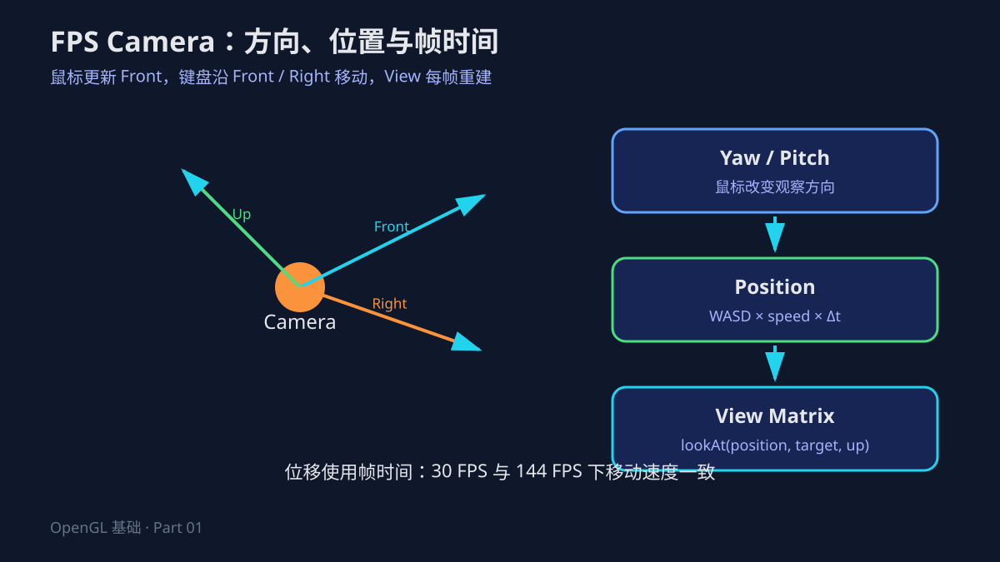

# Part 01 第 12 课：Camera、输入与帧时间

适用环境：C++17、OpenGL 3.3 Core、GLSL 330、GLFW 和 GLM。沿用上一课 MVP 与立方体。

你将学会：

- 用位置、Front 和 World Up 构建 View Matrix。
- 用 Yaw、Pitch 把鼠标输入转换为观察方向。
- 用叉积得到 Right 向量，实现 WASD 平面移动。
- 使用 `deltaTime` 让移动速度不依赖帧率。

完整示例位于 [code/part-01-12-camera](../code/part-01-12-camera/)。

## Camera 的核心状态

示例的 Camera 结构包含：

```cpp
struct Camera {
    glm::vec3 position{0.0F, 0.0F, 6.0F};
    glm::vec3 front{0.0F, 0.0F, -1.0F};
    glm::vec3 up{0.0F, 1.0F, 0.0F};
    float yaw = -90.0F;
    float pitch = 0.0F;
};
```

- `position` 决定观察者在哪里。
- `front` 决定看向哪里。
- `up` 提供世界上方向参考。
- `yaw` 控制左右转向，`pitch` 控制抬头低头。

初始 `yaw = -90°` 对应朝向负 Z。每帧构造：

```cpp
const glm::mat4 view = glm::lookAt(
    camera.position,
    camera.position + camera.front,
    camera.up
);
```

第二个参数不是单独的 Front，而是观察目标点 `position + front`。



## 鼠标输入：先计算位移，再更新方向

GLFW 回调提供当前 Cursor 位置，不直接提供本帧位移：

```cpp
const float dx = static_cast<float>(x) - lastX;
const float dy = lastY - static_cast<float>(y);
lastX = static_cast<float>(x);
lastY = static_cast<float>(y);
```

`dy` 使用旧 Y 减新 Y，因为窗口 Cursor Y 通常向下增加，而抬头需要正 Pitch。

第一次回调只初始化 `lastX/lastY`，避免窗口刚捕获鼠标时产生巨大跳转：

```cpp
if (firstMouse) {
    lastX = static_cast<float>(x);
    lastY = static_cast<float>(y);
    firstMouse = false;
}
```

程序使用 `GLFW_CURSOR_DISABLED` 捕获并隐藏 Cursor，提供连续相对观察体验。按 `Esc` 退出后 Cursor 随窗口销毁恢复。

## Yaw/Pitch 到 Front 向量

```cpp
camera.yaw += dx * 0.12F;
camera.pitch = glm::clamp(camera.pitch + dy * 0.12F, -89.0F, 89.0F);

const float yaw = glm::radians(camera.yaw);
const float pitch = glm::radians(camera.pitch);
camera.front = glm::normalize(glm::vec3{
    std::cos(yaw) * std::cos(pitch),
    std::sin(pitch),
    std::sin(yaw) * std::cos(pitch)
});
```

这组公式把球面角度转换为三维方向。Pitch 限制在 `[-89°,89°]`，避免接近正上方/正下方时 Front 与 World Up 平行，导致方向构造退化。

最后归一化保证 Front 是单位向量，使移动速度不被向量长度改变。

## WASD：沿 Camera 局部方向移动

Right 由 Front 和 World Up 的叉积得到：

```cpp
const glm::vec3 right = glm::normalize(glm::cross(camera.front, camera.up));
```

在本课程右手约定下：

- `W`：`position += speed * front`。
- `S`：沿 Front 反方向。
- `D`：沿 Right 正方向。
- `A`：沿 Right 反方向。

当前移动会随 Pitch 上下倾斜，因为直接使用完整 Front。如果希望典型 FPS 的“只在地平面移动”，可把 Front 投影到 XZ 平面并重新归一化，再计算水平 Right。

## deltaTime：为什么必须乘帧时间

假设期望 Camera 每秒移动 3 个单位。若每帧固定加 0.05：

- 30 FPS 时每秒约移动 1.5。
- 144 FPS 时每秒约移动 7.2。

正确做法是：

```cpp
const double now = glfwGetTime();
const float deltaTime = static_cast<float>(now - previousTime);
previousTime = now;
const float speed = 3.0F * deltaTime;
camera.position += speed * camera.front;
```

`deltaTime` 的单位是秒，因此“速度 × 秒”得到本帧位移。不同帧率下，一秒内累计位移近似相同。

> ⚠️ 断点调试、拖动窗口或系统卡顿可能产生很大的 `deltaTime`。更完整的应用可限制最大步长，或使用固定时间步模拟；本课保留直接形式以突出基本原理。

## 输入、状态与绘制的帧顺序

本课主循环按以下顺序工作：

1. 计算本帧 `deltaTime`。
2. 处理退出与 WASD。
3. 根据最新 Camera 状态构造 View。
4. 使用当前 Framebuffer 尺寸构造 Projection。
5. 清除颜色和深度。
6. 依次设置每个立方体的 Model 并绘制。
7. 交换缓冲并 Poll Events。

鼠标回调由 GLFW 在事件处理过程中触发，更新后的方向用于后续帧。不要假定回调和主循环是两条可同时无同步修改数据的线程。

## 场景中的多个立方体

```cpp
for (const glm::vec3& position : positions) {
    glm::mat4 model{1.0F};
    model = glm::translate(model, position);
    tutorial::setMat4(program, "uModel", model);
    cube.draw();
}
```

所有立方体共享 VAO、VBO、Program、View 和 Projection，只改变 Model 与 Draw Call。这是理解“几何数据”和“物体实例变换”分离的基础。

## 运行示例

```powershell
cd tutorials/opengl-compute-shader/code/part-01-12-camera
cmake --preset debug
cmake --build --preset debug
.\build\debug\part01_12_camera.exe
ctest --preset debug
```

正常窗口中：鼠标观察，WASD 移动，`Esc` 退出。CTest 使用隐藏窗口，不捕获鼠标，仅运行两帧渲染路径。

## 常见错误

### 第一帧突然转向

通常是未处理第一次 Cursor 位置，导致从 `(0,0)` 或旧位置产生巨大 Delta。使用 `firstMouse` 初始化。

### 鼠标向上却低头

检查 Y 差值方向。窗口坐标向下增加，本课使用 `lastY - y` 得到向上为正的输入。

### Camera 移动速度随帧率变化

位移必须乘 `deltaTime`。鼠标转向通常使用事件位移，不应再次乘帧时间，否则同样鼠标移动量会因帧率不同而改变转角。

### 抬头到极限后 View 异常

限制 Pitch，避免 Front 与 Up 共线。若实现自由飞行或 Roll，需要更完整的方向表示。

### Right 方向反了

叉积有顺序。`cross(front, up)` 与 `cross(up, front)` 方向相反，结合坐标系和实际按键结果验证。

## 修改实验与独立练习

1. 添加 Q/E 控制垂直升降。
2. 实现只沿 XZ 平面移动的 WASD，抬头时仍保持水平速度。
3. 添加 Shift 加速，但确保所有位移仍乘同一个 `deltaTime`。
4. 将鼠标灵敏度封装为参数，比较低/高灵敏度，不对 `dx` 乘 `deltaTime`。
5. 独立记录 30 FPS 与 144 FPS 下每秒累计位移，验证帧时间修正。

下一课将完成 Part 01：通过 Depth Test、Face Winding 和 Culling 正确显示并诊断实心立方体。

参考资料：[LearnOpenGL：Camera](https://learnopengl.com/Getting-started/Camera)、[GLFW 输入指南](https://www.glfw.org/docs/latest/input_guide.html)。
