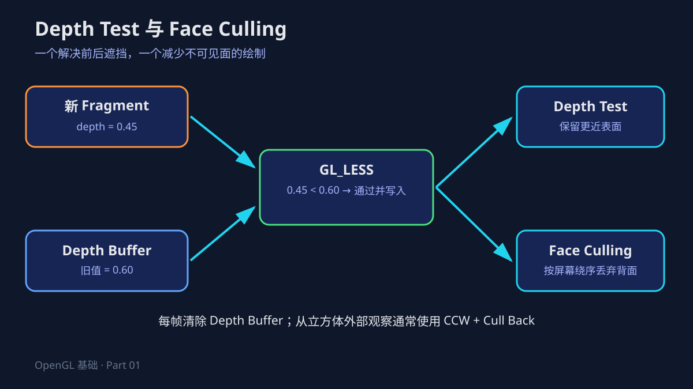

# Part 01 第 13 课：Depth Test、Face Winding 与 Culling

适用环境：C++17、OpenGL 3.3 Core、GLSL 330 和 stb_image。示例绘制两个有重叠的带纹理立方体。

你将学会：

- 解释 Depth Buffer 如何决定 Fragment 是否覆盖旧颜色。
- 正确启用 Depth Test、设置 `GL_LESS` 并逐帧清除深度。
- 区分 Face Winding、Front Face 和 Back-face Culling。
- 通过交互开关诊断遮挡错误和面消失问题。

完整示例位于 [code/part-01-13-depth-culling](../code/part-01-13-depth-culling/)。

## 为什么仅按顺序绘制不够

没有 Depth Test 时，后写入的 Fragment 会覆盖先写入的颜色。三角形在数组中的顺序不等于它们相对 Camera 的远近，因此结果可能错误：

- 远物体的某个面后绘制，盖住近物体。
- 立方体背面后绘制，盖住正面。
- Camera 移动后，固定绘制顺序不再适用。

Depth Buffer 为每个屏幕样本保存当前深度。新 Fragment 到达时，按比较函数决定是否通过并更新。



## 启用 Depth Test

```cpp
glEnable(GL_DEPTH_TEST);
glDepthFunc(GL_LESS);
```

`GL_LESS` 表示新 Fragment 的深度小于已保存深度时通过。在本课程默认深度范围中，更小通常表示更靠近 Camera。

每帧清除：

```cpp
glClear(GL_COLOR_BUFFER_BIT | GL_DEPTH_BUFFER_BIT);
```

若只清颜色不清深度，上一帧的深度会参与下一帧比较，物体可能莫名其妙消失。

默认清除深度通常为 1。需要自定义时使用 `glClearDepth`，但在 Core Profile 中还要正确理解深度写入状态；本课使用默认值即可。

## 深度写入与 Depth Mask

Depth Test 默认还伴随通过后的深度写入。可用以下状态控制：

```cpp
glDepthMask(GL_TRUE);
```

本课保持默认 `GL_TRUE`。以后渲染透明物体时，可能需要“保留 Depth Test 但暂时关闭深度写入”，避免透明排序问题被进一步放大。

`glDisable(GL_DEPTH_TEST)` 后，不应继续期待深度比较保护正确遮挡。示例按 `D` 切换，便于直接观察。

## Face Winding：顶点在屏幕上的绕序

三角形的三个顶点按投影后的屏幕位置可呈顺时针（Clockwise，CW）或逆时针（CCW）。这个顺序称为 Face Winding。

OpenGL 用状态规定哪种绕序算正面：

```cpp
glFrontFace(GL_CCW);
```

本课立方体数据按从外部观察时 CCW 组织。再设置：

```cpp
glCullFace(GL_BACK);
glEnable(GL_CULL_FACE);
```

表示丢弃背面，只保留正面。

示例按 `F` 把 Front Face 在 `GL_CCW` 与 `GL_CW` 间切换。若顶点数据不变，切换后原本的外表面会被视为背面而剔除，立方体外观会明显异常。

## Culling 与 Depth Test 不是一回事

| 机制 | 判断依据 | 主要目的 |
|---|---|---|
| Depth Test | Fragment 深度与 Depth Buffer 旧值 | 解决前后遮挡 |
| Face Culling | 三角形投影后的顶点绕序 | 丢弃不需要的正面或背面 |
| Draw Order | CPU 提交 Draw Call 的顺序 | 影响写入先后，不等于真实远近 |

关闭 Culling 不一定破坏不透明立方体外观，因为 Depth Test 仍能选择近表面，但会增加被遮挡面的 Fragment 工作。关闭 Depth Test 则更容易产生直接可见的错误。

> ⚠️ Culling 依赖一致的顶点绕序。导入模型、应用负缩放或改变坐标 handedness 时，原本正确的面可能反向。遇到“面消失”先暂时关闭 Culling，再检查绕序与变换，而不是立刻修改所有顶点。

## 本课完整状态组合

正常状态：

```cpp
glEnable(GL_DEPTH_TEST);
glDepthFunc(GL_LESS);

glEnable(GL_CULL_FACE);
glCullFace(GL_BACK);
glFrontFace(GL_CCW);
```

交互键：

- `D`：开关 Depth Test。
- `C`：开关 Back-face Culling。
- `F`：切换 CCW/CW Front Winding。
- `Esc`：退出。

这些开关都是持续的 OpenGL 状态，不会在一帧后自动复位。示例每帧根据布尔变量明确设置，方便观察与恢复。

## 两个立方体的绘制

```cpp
const glm::vec3 positions[] = {
    {0.0F, 0.0F, 0.0F},
    {0.55F, 0.25F, -0.65F}
};
for (const glm::vec3& position : positions) {
    glm::mat4 model{1.0F};
    model = glm::translate(model, position);
    tutorial::setMat4(program, "uModel", model);
    cube.draw();
}
```

两个立方体共用几何和纹理。正常 Depth Test 下，重叠区域由真实深度决定；关闭后，第二个立方体的覆盖顺序更容易暴露出来。

## 运行示例与里程碑验收

```powershell
cd tutorials/opengl-compute-shader/code/part-01-13-depth-culling
cmake --preset debug
cmake --build --preset debug
.\build\debug\part01_13_depth_culling.exe
ctest --preset debug
```

正常结果为两个纹理立方体，遮挡稳定、外表面完整。逐项切换 `D`、`C`、`F`，每次观察后恢复正常状态。

完成本课后，Part 01 的里程碑是：能独立创建带纹理立方体场景、移动 Camera、解释 MVP 与插值，并通过开关 Depth Test/Culling 判断渲染状态问题。

## 常见错误

### 忘记请求 Depth Buffer

GLFW 默认窗口通常提供 Depth Buffer，但把 `GLFW_DEPTH_BITS` 显式设为 0 会取消它。若深度行为异常，检查窗口 Hint 和实际 Framebuffer 附件，也可用 RenderDoc 验证，不要只检查 `glEnable`。

### 没有清除 Depth Buffer

每帧应把 `GL_DEPTH_BUFFER_BIT` 加入 `glClear`。窗口尺寸变化不影响这个必要性。

### 所有面都消失

检查 `glFrontFace` 是否与顶点数据一致、`glCullFace` 是否设为预期面，以及 Model 是否含负缩放。先关闭 Culling 做二分诊断。

### 深度相近表面闪烁

这可能是 Z-fighting，不只是“忘记开 Depth Test”。第 3 部会讲非线性深度、Near/Far 和深度冲突处理。

### 以为 Culling 可以替代 Depth Test

Culling 只按朝向丢弃图元，不比较两个正面谁更近。实心场景通常二者都需要。

## 修改实验与独立练习

1. 只关闭 Depth Test，交换两个立方体绘制顺序并记录差异。
2. 保持 Depth Test，关闭 Culling，用 RenderDoc 或 Fragment 计数思路思考额外工作来自哪里。
3. 对一个 Model 使用负 X 缩放，观察绕序与 Culling 的变化。
4. 独立绘制一个开放平面，分别使用正反面观察，解释为什么 Back-face Culling 对单面平面和封闭立方体影响不同。
5. 为程序添加启动自检：确认 Depth Test、Cull Face、Front Face 和 Depth Func 与预期一致。

Part 01 到此完成。后续第 2 部将在此基础上引入法线、材质和光照；当前已删除旧 Part 02 内容，重写时应以本部的统一代码结构为前置。

参考资料：[Khronos Face Culling](https://wikis.khronos.org/opengl/Face_Culling)、[Khronos Rendering Pipeline Overview](https://wikis.khronos.org/opengl/Rendering_Pipeline_Overview)、[LearnOpenGL：Depth Testing](https://learnopengl.com/Advanced-OpenGL/Depth-testing)、[LearnOpenGL：Face Culling](https://learnopengl.com/Advanced-OpenGL/Face-culling)。
