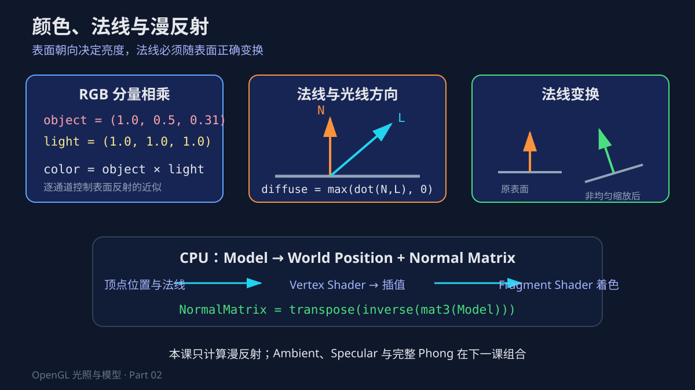

# Part 02 第 1 课：颜色、法线与光照基本量

适用环境：C++17、OpenGL 3.3 Core、GLSL 330、GLFW、GLAD 和 GLM。示例沿用 Part 01 的窗口、Shader、MVP、Depth Test 与 Culling，新增法线属性和漫反射计算。

你将学会：

- 用 RGB 分量表示物体颜色与光源颜色，并理解本课的简化反射模型。
- 区分表面位置、表面法线和指向光源的方向。
- 用点积计算漫反射强度，解释为什么需要归一化与 `max(..., 0.0)`。
- 在 World Space 中传递 Fragment 位置和法线。
- 解释非均匀缩放为什么会破坏法线方向，并用 Normal Matrix 修正。

完整示例位于 [code/part-02-01-lighting-basics](../code/part-02-01-lighting-basics/)。

## 从“给表面一个颜色”到“计算表面响应”

此前的 Fragment Shader 直接输出顶点颜色或纹理颜色。现在加入光源后，最终颜色不再只由物体自身决定，还与以下因素有关：

- 光源发出什么颜色。
- 物体表面对各颜色分量的响应。
- 表面相对光源的朝向。
- 后续课程才会加入的材质、高光、衰减和多光源等因素。

真实光照还包含多次反射、阴影、光谱与材质微表面等复杂现象。本课使用一个便于学习的局部近似：**物体颜色 × 光源颜色 × 漫反射强度**。它能清楚展示数据关系，但不是完整的物理渲染模型。

下图汇总本课的三个核心问题：颜色如何组合、法线如何参与点积，以及法线如何随 Model 变换。



这张图的关键结论是：位置和法线都来自顶点数据，但进入 World Space 时使用不同的矩阵；Fragment Shader 再把世界位置、世界法线和光源位置组合成亮度。

## RGB 颜色与分量乘法

本课用三个 `[0,1]` 范围内的浮点数表示 RGB 颜色：

```cpp
const glm::vec3 objectColor{1.0F, 0.5F, 0.31F};
const glm::vec3 lightColor{1.0F, 1.0F, 1.0F};
```

`objectColor` 描述珊瑚色物体，`lightColor` 描述白光。在本课的简化模型中，二者按分量相乘：

```text
object = (1.0, 0.5, 0.31)
light  = (1.0, 1.0, 1.0)
result = (1.0, 0.5, 0.31)
```

如果把光源改为暗绿色：

```text
light  = (0.33, 0.42, 0.18)
result = (0.33, 0.21, 0.0558)
```

红色通道并不是被“改成绿色”，而是该通道的入射光与物体响应共同变弱。GLSL 中两个 `vec3` 使用 `*` 就是逐分量乘法：

```glsl
vec3 reflectedColor = uObjectColor * uLightColor;
```

> ⚠️ 这里暂时把 `[0,1]` 数值直接用于光照计算，没有展开线性颜色空间与 Gamma Correction。把纹理、显示变换和光照混合到同一颜色空间的问题会在第 3 部单独讲解。

## 法线：描述表面朝向，而不是表面位置

**法线（Normal）**是垂直于局部表面的方向向量。对平面而言，整个面可以共享一条法线；对光滑曲面而言，通常让每个顶点携带法线，再在三角形内部插值。

一个孤立的顶点只是位置，本身没有唯一的表面方向。法线来自它所属的面或周围几何。以立方体为例，可以直接为六个面指定：

| 面 | 法线 |
|---|---|
| 正 X | `(1,0,0)` |
| 负 X | `(-1,0,0)` |
| 正 Y | `(0,1,0)` |
| 负 Y | `(0,-1,0)` |
| 正 Z | `(0,0,1)` |
| 负 Z | `(0,0,-1)` |

这些法线都是单位向量。若已知三角形顶点 `p0/p1/p2`，也可根据绕序用两条边的叉积求面法线，例如 `normalize(cross(p1-p0, p2-p0))`；交换叉积顺序会反转方向。导入平滑模型时则不能简单把每个三角形的面法线代替全部顶点法线，否则曲面会呈现硬分面效果。

本课示例实际使用具有 8 个三角形斜面的八面体。这样每个面法线都含多个非零分量，非均匀缩放下的正确与错误法线变换会产生可观察差异。轴对齐的立方体不适合这个特定对照：对只有单轴分量的面法线，直接缩放与逆转置缩放后再归一化可能得到相同方向。

### 在顶点数组中加入法线

示例把每个顶点改为 6 个 `float`：前三个是位置，后三个是法线。

```cpp
const glm::vec3 normal =
    glm::normalize(glm::cross(p1 - p0, p2 - p0));
vertices.push_back({p0.x, p0.y, p0.z,
    normal.x, normal.y, normal.z});
```

同一个三角形面的 3 个顶点共享由叉积求得的法线。Attribute 配置也必须与 6 个 `float` 的布局同步：

```cpp
glVertexAttribPointer(0, 3, GL_FLOAT, GL_FALSE,
    6 * sizeof(float), nullptr);
glEnableVertexAttribArray(0);

glVertexAttribPointer(1, 3, GL_FLOAT, GL_FALSE,
    6 * sizeof(float),
    reinterpret_cast<void*>(3 * sizeof(float)));
glEnableVertexAttribArray(1);
```

- Location `0` 是位置，Location `1` 是法线。
- 两者的 Stride 都是 `6 * sizeof(float)`，因为下一个顶点的同类数据要跨过整个顶点。
- 法线的 Offset 是 `3 * sizeof(float)`，因为前面有三个位置分量。
- 法线只是方向，不需要像位置一样附加齐次坐标 `w=1`，也不能应用平移。

## 漫反射：用法线与光线方向的夹角控制亮度

本课只计算 **Diffuse Lighting（漫反射）**：表面越正对光源，漫反射越强；表面背向光源时，不产生这一项光照。

设：

- `N`：从表面向外的单位法线。
- `L`：从当前 Fragment 指向光源的单位向量。
- `θ`：二者夹角。

单位向量满足：

```text
dot(N,L) = cos(θ)
```

因此：

| 表面朝向 | 点积 | 本课漫反射 |
|---|---:|---:|
| 正对光源，`θ=0°` | `1` | 最强 |
| 与光线方向垂直，`θ=90°` | `0` | 为零 |
| 背向光源，`θ>90°` | 负数 | 截断为零 |

Fragment Shader 的核心计算为：

```glsl
vec3 normal = normalize(vWorldNormal);
vec3 lightDir = normalize(uLightPos - vWorldPos);
float diffuseFactor = max(dot(normal, lightDir), 0.0);
vec3 litColor = uObjectColor * uLightColor * diffuseFactor;
FragColor = vec4(litColor, 1.0);
```

`normalize` 把向量改为同方向的单位向量。只有方向向量归一化后，点积才直接等于夹角余弦，不会被向量长度意外放大或缩小。`max(...,0.0)` 防止背光面产生负颜色。

本课故意不添加 Ambient 和 Specular，因此背光面会是黑色。这不是最终 Phong 效果，而是为了单独观察漫反射；下一课再组合三个分量。

> ⚠️ 不要对零向量调用 `normalize`。示例使用单位法线且光源不在物体表面上；修改场景时仍需避免零长度法线、零缩放导致的退化变换，以及光源与 Fragment 位置完全重合。

## 为什么需要世界位置与世界法线

`uLightPos` 是 World Space 中的位置，所以参与运算的 Fragment 位置和法线也必须转换到同一空间。不能在 World Space 光源与 Clip Space 顶点之间直接相减。

Vertex Shader 分两条路径输出数据：

```glsl
vec4 worldPos = uModel * vec4(aPos, 1.0);
vWorldPos = worldPos.xyz;
vWorldNormal = uNormalMatrix * aNormal;
gl_Position = uProjection * uView * worldPos;
```

- `worldPos` 只经过 Model，仍是 World Space，供光照使用。
- `gl_Position` 继续经过 View 和 Projection，供光栅化与屏幕显示使用。
- `vWorldPos` 和 `vWorldNormal` 经三角形插值后进入 Fragment Shader。
- 法线在 Fragment Shader 中再次归一化，因为插值后的向量一般不保持单位长度。

数据流如下：

```text
aPos -----> uModel -------------> vWorldPos --+
                                              +--> lightDir --> dot --> diffuse
aNormal --> uNormalMatrix ------> vWorldNormal+
uLightPos ------------------------------------+
```

位置使用 `uModel`，法线使用 `uNormalMatrix`，二者不能随意交换。

## Normal Matrix：非均匀缩放下的法线修正

### 为什么不能总是使用 `mat3(uModel)`

取 Model 左上角的 `3×3` 部分可以去掉平移，这对方向是必要的。但若 Model 含非均匀缩放，直接用法线乘同一个线性变换，通常不再垂直于变换后的表面。

例如，把物体沿 X 拉长、沿 Y 压扁：

```cpp
model = glm::scale(model, glm::vec3{1.4F, 0.65F, 1.0F});
```

位置应当按这个比例改变；法线若也按相同比例改变，其方向会发生错误偏转，导致明暗不再符合实际表面朝向。

只有旋转而没有缩放时，旋转矩阵可直接用于法线。只有各轴等比例且为正的 Uniform Scale 时，法线方向不变，之后重新归一化即可。问题主要出现在非均匀缩放及更一般的剪切变换中。

### 逆转置为何能保持垂直

设 Model 的线性部分为 `M`，原表面切向量为 `T`，原法线为 `N`。垂直意味着：

```text
dot(N,T) = 0
```

变换后切向量是 `M*T`。若法线使用：

```text
NormalMatrix = transpose(inverse(M))
```

则变换后的法线仍满足与 `M*T` 垂直。用矩阵写法可直观看到 `inverse(M)` 与 `M` 相消：

```text
transpose(NormalMatrix*N) * (M*T)
= transpose(N) * inverse(M) * M * T
= transpose(N) * T
= 0
```

因此，在 World Space 计算光照时，Normal Matrix 取 **Model 左上角 `3×3` 矩阵的逆转置**。如果在 View Space 计算光照，则应从对应的 Model-View 线性部分构造，并保证光源位置也在 View Space。

CPU 端使用 GLM 计算并上传：

```cpp
const glm::mat3 normalMatrix =
    glm::transpose(glm::inverse(glm::mat3(model)));

glUniformMatrix3fv(
    glGetUniformLocation(objectProgram, "uNormalMatrix"),
    1,
    GL_FALSE,
    glm::value_ptr(normalMatrix)
);
```

`glUniformMatrix3fv` 的关键参数依次是 Uniform Location、矩阵数量、是否转置和矩阵数据指针。本课已经显式完成所需转置，因此第三个参数保持 `GL_FALSE`；不要再用它逆转矩阵变换顺序。

在 CPU 上每个物体计算一次，可以避免在 Vertex Shader 中为每个顶点重复求逆。Model 每帧变化时，Normal Matrix 也要同步更新。

> ⚠️ 零缩放会让矩阵不可逆，使 Normal Matrix 无有效结果。需要完全隐藏物体时，不要通过把某一轴缩放为零来测试法线变换。

## 示例如何组织两次绘制

示例使用同一个带位置和法线的八面体 VBO/VAO，分别绘制：

1. 使用光照 Program 绘制旋转并非均匀缩放的珊瑚色物体。
2. 使用不受光照影响的 Program，在 `uLightPos` 绘制白色小八面体，标记光源位置。

光源标记只是可视化辅助；真正参与漫反射的是 Uniform `uLightPos`。移动标记却不更新这个 Uniform，或只更新 Uniform 而不移动标记，都会让画面位置与光照结果不一致。

主循环中每个物体的 Model 不同，因此分别设置 Uniform 并发出 Draw Call。View 与 Projection 由两个 Program 共享同一组数值，但 OpenGL Uniform 属于 Program 状态，所以仍需分别上传。

## 运行与交互

```powershell
cd tutorials/opengl-compute-shader/code/part-02-01-lighting-basics
cmake --preset debug
cmake --build --preset debug
.\build\debug\part02_01_lighting_basics.exe
ctest --preset debug
```

正常结果为一个旋转的珊瑚色八面体和一个白色光源标记。朝向光源的面更亮，背光面为黑色。

交互键：

- `N`：在正确的逆转置 Normal Matrix 与直接 `mat3(model)` 之间切换。
- `V`：把法线从 `[-1,1]` 映射到 `[0,1]` 并作为 RGB 输出，暂时绕过光照。
- `Esc`：退出。

`N` 实验需要在当前非均匀缩放下观察；若把缩放改为 `(1,1,1)`，两种方式的差异会消失。八面体的斜法线让这个实验有效，不要把它替换为轴对齐立方体后仍期待同样明显的差异。`V` 模式用于检查方向是否连续、是否反转，不代表最终材质颜色。

CTest 使用隐藏窗口运行两帧，验证配置、编译、Context、Shader 和 Draw Call 路径；视觉差异仍需在普通窗口中观察。

## 常见错误

### 整个物体仍然是纯色

检查 Fragment Shader 是否真的使用了 `diffuseFactor`，以及 `uLightPos` 是否已设置。若每个面的法线都相同，也会失去正常的面间明暗差异。

### 所有面全黑或亮度异常

先按 `V` 检查法线，再确认位置与法线的 Attribute Stride/Offset 都是按 6 个 `float` 配置。随后检查 `uLightPos` 与 Fragment 是否位于同一坐标空间。

### 点积结果大于 1 或光照随距离意外变化

确认 `N` 与 `L` 都已归一化。本课没有实现距离衰减；若代码仍随距离改变亮度，应检查是否把未归一化的 `uLightPos-vWorldPos` 直接用于点积。

### 平移物体后法线异常

不要把含平移的 `mat4` 当作位置直接乘到 `vec3` 法线上。本课使用 Model 的 `3×3` 线性部分构造 Normal Matrix，平移不会改变法线。

### 非均匀缩放后明暗看起来歪斜

检查是否误用 `mat3(model)`。按 `N` 对照正确与错误路径，并确认 Model 更新后 Normal Matrix 也重新计算。

### 光源标记正确，但光照方向不对

白色小八面体只是标记。检查传给光照 Program 的 `uLightPos` 是否与标记位置一致，以及光线方向是否写成了 `uLightPos-vWorldPos`；反向相减会改变点积结果。

## 修改实验与独立练习

1. 把 `uLightColor` 改为 `(0.33,0.42,0.18)`，手算三个颜色通道，再与画面定性比较。
2. 把缩放改为 `(1,1,1)`，按 `N` 观察两种法线变换为何此时等价；再改为 `(2.0,0.5,1.0)` 重复实验。
3. 暂时删除 Fragment Shader 中对法线的第二次 `normalize`，比较平面与曲面情况，并解释插值为何需要它。
4. 为三角形计算面法线：使用 `p0=(0,0,0)`、`p1=(1,0,0)`、`p2=(0,1,0)`，验证叉积方向和顶点绕序的关系。
5. 把全部光照改到 View Space：同步变换 Fragment 位置、法线和光源位置，并用数值或画面对照 World Space 版本。
6. 不参考本课代码，从零为一个具有位置与法线属性的平面写出最小漫反射 Shader。

下一课将加入 Ambient 与 Specular，把当前单独的 Diffuse 扩展为完整 Phong 光照，并分别显示各分量的贡献。

参考资料：[LearnOpenGL：Colors](https://learnopengl.com/Lighting/Colors)、[LearnOpenGL：Basic Lighting](https://learnopengl.com/Lighting/Basic-Lighting)、[Khronos `dot`](https://registry.khronos.org/OpenGL-Refpages/gl4/html/dot.xhtml)、[Khronos `normalize`](https://registry.khronos.org/OpenGL-Refpages/gl4/html/normalize.xhtml)、[Khronos `glUniform`](https://registry.khronos.org/OpenGL-Refpages/gl4/html/glUniform.xhtml)、[Song Ho Ahn：Normal Vector Transformation](https://www.songho.ca/opengl/gl_normaltransform.html)。
